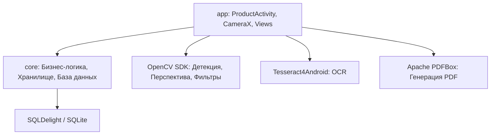
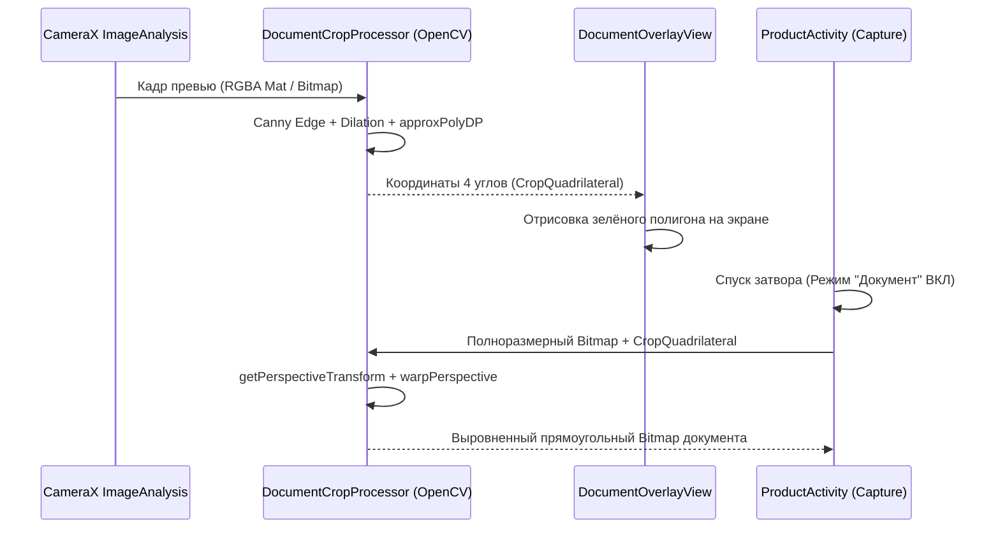

# Архитектура DocScan 🏛️

Документ описывает системную архитектуру, потоковую модель, каноническую структуру данных страницы, управление жизненным циклом и организацию модулей приложения DocScan по состоянию на версию **0.4.243**.

---

## 1. Модульная организация

Кодовая база строго разделена на два изолированных Gradle-модуля:



### 1.1. Модуль `:core` (Pure Kotlin / JVM)
Не зависит от Android SDK (за исключением абстракций над системным временем и файловой системой), что обеспечивает 100% покрытие быстрыми юнит-тестами на JVM:
* **`app.docscan.core.store`**: `StateStore`, MVI-команды (`StoreCommands`), контракты транзакций и событий.
* **`app.docscan.core.artifact`**: `FileArtifactRepository` — физическое хранение файлов, вычисление хэшей, ротация и очистка артефактов.
* **`app.docscan.core.store.RecognitionLayout`**: каноническая модель карты страницы (`RecognitionLayout`, `OcrBlock`, `OcrParagraph`, `OcrLine`, `OcrWord`, `Baseline`, `NormalizedBox`, `BlockType`, `LayoutQuality`).
* **`app.docscan.core.ocr`**: чистая логика нормализации геометрии `LayoutExtractor` и структурный парсер `HocrParser`.
* **`app.docscan.core.edit`**: математические модели манипуляций со страницами (`RightAngleRotationDraft`, `PageImageEditDraft`, `CropQuadrilateral`).
* **`app.docscan.core.export`**: генерация уникальных имен документов, разрешение коллизий имен файлов (`OutputNameResolver`, `OutputBasenameSuggester`).
* **`sqldelight/app/docscan/core/db`**: схема базы данных и файлы миграций (`1.sqm` ... `11.sqm`).

### 1.2. Модуль `:app` (Android Application)
Отвечает за взаимодействие с платформой Android, аппаратными сенсорами и отрисовку UI:
* **Камера**: AndroidX CameraX (захват фото, превью, фоновый анализ кадров `ImageAnalysis`).
* **Компьютерное зрение**: интеграция с нативной библиотекой OpenCV для поиска контуров, оверлея полигона `DocumentOverlayView` и гомографического выравнивания перспективы (`DocumentCropProcessor`).
* **Распознавание текста**: Tesseract 4/5 через обертку `tesseract4android` и нативный обход дерева через C++ API `ResultIteratorLayoutExtractor`.
* **Интерфейс**: полностью программные Views без XML-разметки, кастомные оверлеи и хост диалоговых окон `InsetDialogHost`.
* **Экспорт и внешние хранилища**: `SafExportGateway`, `SafDestinationGrantManager`, `SafRuntimeDestinationCheck`, `DocScanPublisher`.
* **Редактирование существующих PDF**: `SavedPdfEditSession`, `SavedPdfEditComposer`, `SavedPdfPageRenderer`.

---

## 2. Каноническая архитектура страницы (Canonical Page Architecture)

Ключевой архитектурный принцип DocScan: **OCR моделируется не как плоский текст, а как структурированная карта страницы (`RecognitionLayout`)**, привязанная к неизменяемой версии изображения.

```
       CAMERA / IMAGE / PDF
                 │
                 ▼
 ┌──────────────────────────────┐
 │  Canonical Page Preparation  │
 │  - EXIF orientation          │
 │  - perspective correction    │
 │  - crop                      │
 │  - deskew                    │
 └──────────────┬───────────────┘
                │
        canonicalImageVersion
                │
        ┌───────┴────────┐
        │                │
        ▼                ▼
  VISUAL IMAGE       OCR IMAGE
        │            grayscale
        │            normalize lighting
        │            denoise
        │            threshold
        │                │
        │                ▼
        │          Tesseract
        │                │
        │                ▼
        │       LayoutExtractor
        │                │
        │    ResultIterator / TSV / hOCR
        │                │
        │                ▼
        │        GeometryNormalizer
        │                │
        │                ▼
        │       RecognitionLayout V2
        │                │
        └────────┬───────┘
                 ▼
         transactional commit
                 │
        imageVersionId bound
                 │
        ┌────────┼─────────┐
        ▼        ▼         ▼
       UI      Search     PDF
```

### 2.1. Этапы канонического конвейера:
1. **Canonical Page Preparation**: исходное изображение нормализуется (учет EXIF-ориентации, автоматическое или ручное выравнивание перспективы, обрезка). Результат фиксируется как каноническая версия страницы `canonicalImageVersion`.
2. **Разделение представлений**:
   * **Visual Image**: полноцветный мастер-растр для отображения пользователю и вставки в подложку PDF.
   * **OCR Image**: предобработанный растр (оттенки серого, нормализация освещения, устранение шумов, адаптивная бинаризация) для максимальной точности Tesseract.
3. **Layout Extraction**: нативный C++ `ResultIterator` обходит блоки, параграфы, строки и слова. При сбое подключается резервный `HocrParser`.
4. **Geometry Normalization**: координаты приводятся к единому нормализованному базису `[0.0 .. 1.0]` в `NormalizedBox`, вычисляются линии базового шрифта (`Baseline`).
5. **Transactional Commit**: полученный `RecognitionLayout` атомарно записывается в SQLite через `StateStore`, навсегда привязываясь к конкретному `imageVersionId`.

---

## 3. Жизненный цикл данных и безопасность артефактов

В DocScan действует строгий принцип **неизменяемости исходных данных (Immutability)**:

```
[Камера / Галерея]
        │
        ▼
   original.jpg ─── (Master-файл: доступен ТОЛЬКО для чтения, никогда не меняется)
        │
        ├──────────────────────┬──────────────────────┐
        ▼                      ▼                      ▼
  edit_draft_1.jpg       rotated_90.jpg          crop_rect.jpg
   (Производный)         (Производный)           (Производный)
        │                      │                      │
        └──────────────────────┼──────────────────────┘
                               ▼
                        thumbnail_103x75.jpg
                           (Кэш эскиза)
```

1. **Оригинал защищен от перезаписи**: исходный захваченный кадр камеры сохраняется в закрытое хранилище приложения как мастер-копия.
2. **Все манипуляции создают новые версии**: поворот на 90°, обрезка или цветокоррекция создают новый файл с уникальным идентификатором. При отмене правок (Undo) приложение мгновенно возвращается к предыдущей версии без потери качества.
3. **Безопасная сборка мусора (`CleanupArbiter`)**: удаление файлов с диска производится только тогда, когда в базе данных `StateStore` не осталось ни одной ссылки на данный артефакт ни в текущих сессиях, ни в истории отмены.

---

## 4. UI Архитектура (Camera-First & No-XML)

### 4.1. Философия Camera-First
Пользовательский интерфейс построен вокруг видоискателя камеры:
* Приложение запускается мгновенно в режиме видоискателя.
* Серийная съёмка не блокирует интерфейс: кадры ставятся в очередь, эскизы асинхронно появляются в нижней ленте.
* Высота нижней панели строго ограничена (не более 175 dp) для сохранения максимального обзора камеры.

### 4.2. Архитектура окон (`InsetDialogHost`)
Все диалоги и окна детального просмотра (Page Viewer, сохранение PDF, настройки) управляются единым хостом:
* **Адаптивная геометрия**: панели используют режим `WRAP_CONTENT` с динамическими ограничениями минимальной и максимальной высоты, предотвращая выход за границы безопасной зоны экрана (`WindowInsets`).
* **Размытие заднего плана (Backdrop Blur)**:
  * Android 12+ (API 31+): аппаратный `RenderEffect.createBlurEffect()`.
  * Android 10–11 (API 29–30): малоразмерный снимок экрана через `PixelCopy` с программным фильтром.

### 4.3. Векторный оверлей видоискателя (`DocumentOverlayView`)
* Прозрачный компонент, расположенный непосредственно поверх `PreviewView` камеры.
* Принимает нормализованные координаты 4 углов документа из потока `ImageAnalysis`.
* Выполняет матричное преобразование с учетом соотношения сторон и ориентации сенсора камеры.
* Отрисовывает зелёный контур (`#22C55E`), угловые маркеры и полупрозрачную заливку.

---

## 5. Конвейер детекции и коррекции перспективы



Подробное математическое описание приведено в [`docs/DOCUMENT_DETECTION_AND_RECTIFICATION.md`](DOCUMENT_DETECTION_AND_RECTIFICATION.md).

---

## 6. Распознавание текста и генерация Searchable PDF

```mermaid
flowchart LR
    Img[Кадр страницы] --> Tess[Tesseract 4/5 Engine]
    Tess --> Extractor[ResultIteratorLayoutExtractor]
    Extractor --> HIERARCHY[RecognitionLayout: Блоки -> Строки с Baseline -> Слова]
    HIERARCHY --> PDF[SearchablePdfWriter (PDFBox)]
    Img --> PDF
    PDF --> Result[Итоговый двухслойный PDF]
```

1. **Tesseract Engine**: выполняет бинаризацию и оптическое распознавание символов (поддержка русского и английского языков).
2. **`ResultIteratorLayoutExtractor`**: обходит дерево распознавания через нативный C++ итератор:
   * Извлекает точные границы каждого слова и базовую линию строк (`Baseline`).
   * Гарантирует корректное удаление нативного дескриптора памяти через `deleteResultIterator`.
3. **Apache PDFBox (`SearchablePdfWriter`)**:
   * Создает страницу документа с точным размером исходного изображения.
   * Помещает сжатый растровый слой (JPEG) на фон.
   * Поверх растра накладывает невидимый текстовый слой (рендеринг прозрачным шрифтом `RenderingMode.NEITHER_FILL_NOR_STROKE`), точно совмещая символы с их графическим начертанием на фото с учетом `Baseline`.

Подробности реализации описаны в [`docs/OCR_AND_SEARCHABLE_PDF.md`](OCR_AND_SEARCHABLE_PDF.md).

---

## 7. Внешний экспорт и интеграция Storage Access Framework (SAF)

DocScan сохраняет файлы в общее хранилище пользователя через Android Storage Access Framework:
1. **Персистентность разрешений (`SafDestinationGrantManager`)**: приложение сохраняет URI выбранного каталога (`takePersistableUriPermission`) для последующих сессий сохранения.
2. **Рантайм-проверка перед записью (`SafRuntimeDestinationCheck`)**:
   * Создается уникальный тестовый файл `_docscan_test_<timestamp>.tmp`.
   * Записывается блок данных с контрольной суммой и считывается обратно.
   * Тестовый файл удаляется. Только после этого запускается экспорт целевого документа.
3. **Диалог сохранения (`showModernSaveDialog`)**:
   * Автоматическая генерация имени на базе OCR первого листа + даты (`OutputBasenameSuggester`).
   * Независимые тумблеры: «Включить текстовый слой (OCR)» и «Сохранять также отдельные JPG».

---

## 8. Повторное редактирование сохраненных PDF (Saved PDF Re-editing)

DocScan поддерживает открытие и модификацию ранее созданных PDF без потери качества:
* **`SavedPdfPageRenderer`**: постраничный рендеринг страниц PDF в растровые изображения через системный `PdfRenderer`.
* **`SavedPdfEditSession` & `SavedPdfEditComposer`**: управление сессией редактирования (добавление новых снимков с камеры, удаление страниц, поворот, изменение порядка в `PdfPageRail`).
* **Безопасность оригинала**: измененный документ всегда сохраняется как новая редакция (`имя (изм.).pdf`), оригинал никогда не перезаписывается.

---

## 9. Потоковая модель и защита от OOM (Out Of Memory)

При обработке многостраничных документов высокого разрешения (до 50 Мп на современных смартфонах) действуют жесткие лимиты памяти:

1. **Пулы потоков**:
   * **Main/UI Thread**: только диспетчеризация событий интерфейса и анимации.
   * **Thumbnail Executor**: выделенный ограниченный пул (2 потока) с приоритетом `THREAD_PRIORITY_BACKGROUND` для декодирования эскизов.
   * **Heavy Work Executor**: однопоточная очередь с блокировкой тяжелых операций (OCR, PDF компиляция, полноразмерная гомография), предотвращающая одновременное нахождение нескольких несжатых полноразмерных Bitmap в памяти.
2. **Управление памятью Bitmap**:
   * Принудительное масштабирование при декодировании (`inSampleSize`) для всех превью и аналитических кадров.
   * Явный вызов `.recycle()` на промежуточных растрах сразу после завершения операций OpenCV или сохранения на диск.
   * Двухуровневый кэш эскизов (`LruCache` в оперативной памяти ограничен 24 изображениями).
