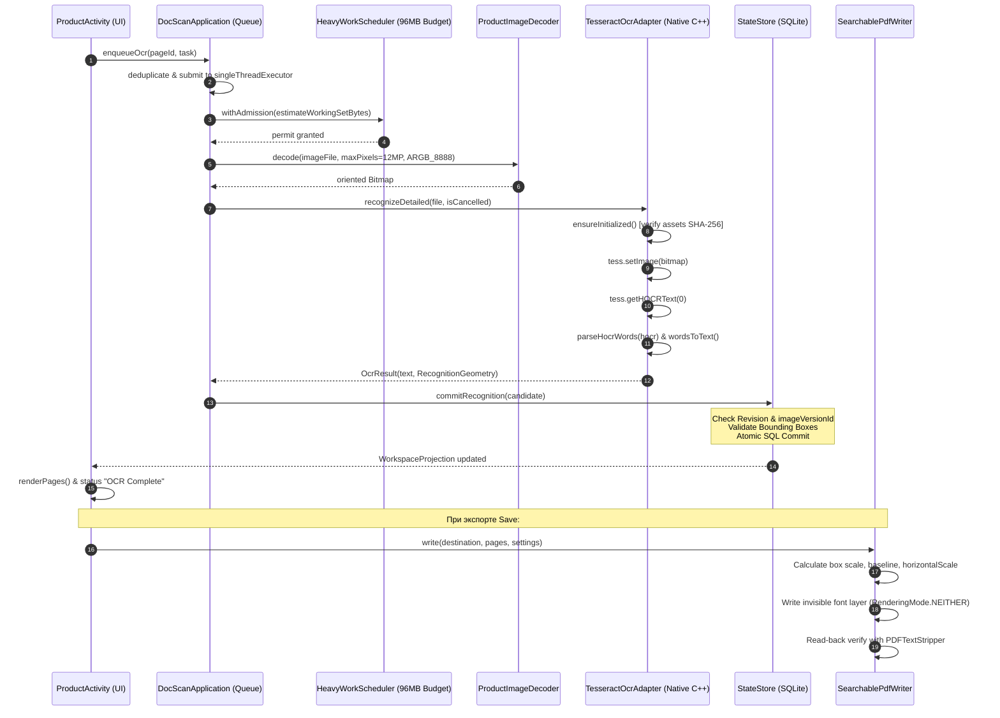

# Архитектура и реализация OCR в DocScan: Детальный обзор с кодом для аудита и поиска ошибок

Настоящий документ подготовлен для комплексного анализа и автоматизированного/экспертного аудита реализации OCR в проекте DocScan. В документе приведены полные схемы жизненного цикла, архитектурные контракты, точные фрагменты исходного кода ключевых компонентов (адаптер, планировщик, транзакционное хранилище, кодек геометрии, генератор searchable PDF, UI-контроллеры) и детальный реестр выявленных дефектов, граничных случаев и архитектурных рисков.

---

## Содержание

1. [Общая архитектура и контекст реализации](#1-общая-архитектура-и-контекст-реализации)
   - 1.1. Эволюция: Spike Harness (ML Kit) vs Production (Tesseract rus+eng)
   - 1.2. Бизнес-требования (UFS CAP-005) и Frozen-инварианты
   - 1.3. Принятые системные решения (Decisions Ledger)
2. [Компоненты подсистемы OCR и поток данных](#2-компоненты-подсистемы-ocr-и-поток-данных)
   - 2.1. End-to-End Pipeline (Сквозной сценарий)
   - 2.2. Архитектурная диаграмма потока данных
3. [Полный исходный код компонентов OCR](#3-полный-исходный-код-компонентов-ocr)
   - 3.1. Адаптер распознавания: `TesseractOcrAdapter.kt`
   - 3.2. Кодек геометрии: `RecognitionPayloadCodec.kt`
   - 3.3. Модели данных геометрии: `StoreModels.kt`
   - 3.4. Транзакционный коммит и верификация: `StateStore.kt` & `Schema.sq`
   - 3.5. Очередь и управление отменой: `DocScanApplication.kt`
   - 3.6. Планирование и UI-интеграция: `ProductActivity.kt`
   - 3.7. Интеграция в PDF: `SearchablePdfWriter.kt` & `FrozenSaveOutputComposer.kt`
   - 3.8. Вспомогательные компоненты: `ProductImageDecoder.kt` и `OutputBasenameSuggester.kt`
4. [Детальный анализ проблем, ошибок и рисков](#4-детальный-анализ-проблем-ошибок-и-рисков)
   - 4.1. Критические дефекты рантайма (Fatal Exceptions / Crashes)
   - 4.2. Алгоритмические и геометрические дефекты
   - 4.3. Проблемы многопоточности, гонок и отмены
   - 4.4. Проблемы расхода памяти (OOM / Native Leaks)
   - 4.5. Аппаратная и платформенная совместимость (OEM / Android OS)
   - 4.6. Расхождения со спецификацией UFS и незакрытые граничные сценарии
5. [Сводная матрица дефектов для аудита](#5-сводная-матрица-дефектов-для-аудита)

---

## 1. Общая архитектура и контекст реализации

### 1.1. Эволюция: Spike Harness (ML Kit) vs Production (Tesseract rus+eng)

В кодовой базе DocScan присутствуют две ветки реализации OCR:
1. **Spike / Diagnostic Harness (`app` module, пакет `com.example.docscanspike`):**
   - Класс: `OcrAdapter.java`.
   - Движок: Google ML Kit Text Recognition v2 (`com.google.mlkit:text-recognition:16.0.0`).
   - Назначение: исследовательский спайк (S3 Harness) для измерения PSS/PrivateDirty памяти и латентности на API 36+. Ограничен распознаванием только Latin script.
2. **Production Core (`core` + `product` modules, пакет `app.docscan`):**
   - Класс: `TesseractOcrAdapter.kt`.
   - Движок: `cz.adaptech.tesseract4android:tesseract4android:4.9.0` (Native C++ Tesseract 5.x через JNI).
   - Модели: офлайн-модели `rus.traineddata` + `eng.traineddata` (tessdata_fast, коммит `87416418657359cb625c412a48b6e1d6d41c29bd`), запакованные в `assets` APK и устанавливаемые во внутреннее хранилище `filesDir`.
   - Выходные данные: полный текст + поэлементная геометрия слов (bounding boxes, confidence).

### 1.2. Бизнес-требования (UFS CAP-005) и Frozen-инварианты

Согласно `User Functional Specification v1 — FREEZE CANDIDATE` (CAP-005):
- **BR-005-01:** OCR для основного потока capture/import запускается автоматически в фоне и не блокирует UI/съёмку.
- **BR-005-02:** Результат OCR всегда привязан к конкретному `imageVersionId`.
- **BR-005-03:** OCR от другой `imageVersionId` невалиден для текущей версии страницы.
- **BR-005-04:** После графического сохранения (Crop, Rotate, Filter Adjustments) новая `imageVersionId` **не имеет валидного OCR до явного Re-OCR**; старый OCR остаётся привязан к предыдущей версии.
- **BR-005-05:** Re-OCR не создаёт новую страницу, сохраняет `pageId`, порядковый номер и статус выделения (`selected`).
- **BR-005-06:** Существующий OCR заменяется только при успешном завершении нового Re-OCR; при сбое старый результат сохраняется.
- **BR-005-07:** При ошибке OCR выставляется статус Failed с возможностью повтора (Retry).
- **BR-005-09:** Searchable PDF формируется объединением видимого растра страницы и невидимого текстового слоя OCR той же `imageVersionId`.
- **BR-005-11:** Многоязычный OCR должен поддерживать автоматическое определение языка.

### 1.3. Принятые системные решения (Decisions Ledger)

- **`CONFLICT-07` / `ENG-OCR-01`:** В официальном Google ML Kit v2 отсутствует поддержка русского языка (Cyrillic). Поэтому для production выбран офлайн Tesseract4Android 4.9.0 со скомбинированным словарем `rus+eng`.
- **`ENG-OCR-GEO-01`:** Геометрия слов, confidence, размеры исходного изображения сохраняются в существующей колонке SQLite `Recognition.payload` в версионированном Base64-конверте (`DOCSCAN-OCR-GEOMETRY/1`). Это сохранило обратную совместимость со старыми текстовыми записями без выполнения миграции БД.
- **`ENG-SELECT-READY-02`:** Страницы съёмки несут флаг `select_when_ready = 1`. При успешном коммите распознавания (`commitCurrentRecognition`) страница автоматически помечается выделенной (`selected = 1`), если пользователь до этого вручную не изменил выбор.

---

## 2. Компоненты подсистемы OCR и поток данных

### 2.1. End-to-End Pipeline (Сквозной сценарий)

1. **Инициирование:**
   - После сохранения снимка с камеры (`ProductActivity.kt` L1681), импорта фото/PDF или ручного нажатия кнопки «Распознать» (`scheduleOcr(..., force = true)`).
2. **Очередь (`DocScanApplication.kt`):**
   - `enqueueOcr(pageId)` регистрирует задачу в `ConcurrentHashMap<PageId, OcrJob>`.
   - Выполняется на однопоточном пуле `ocrExecutor` (`Executors.newSingleThreadExecutor()`).
3. **Контроль памяти (`HeavyWorkScheduler.kt`):**
   - Оценивается размер рабочего набора байт: `estimateDecodedWorkingSetBytes(imageFile)` (до 96 МиБ).
   - Запрашивается допуск (`withAdmission`). Не более 1 тяжелой фоновой задачи одновременно.
4. **Декодирование и нормализация (`ProductImageDecoder.kt`):**
   - Декодирование файла в `Bitmap.Config.ARGB_8888`.
   - Приведение к ориентации по EXIF (поворот/отражение) в памяти.
   - Ограничение размера до 12 мегапикселей (`MAX_BITMAP_PIXELS`).
5. **Распознавание (`TesseractOcrAdapter.kt`):**
   - Проверка инициализации (`ensureInitialized`): распаковка моделей из assets при первом запуске с проверкой SHA-256.
   - Вызов native JNI: `tess.setImage(decoded)` и `tess.getHOCRText(0)`.
   - Регулярными выражениями парсится hOCR HTML: извлекаются слова `<span class='ocrx_word'>`, координаты `bbox`, `confidence`.
   - Восстановление строк (`wordsToText`) по вертикальному перекрытию соседних слов.
6. **Транзакционный коммит (`ProductActivity` -> `ProductStorage` -> `StateStore`):**
   - Формируется `RecognitionCandidate`.
   - В транзакции SQLite проверяется ревизия страницы: если страница была удалена, переснята или отредактирована, бросается `StoreConflict` и результат OCR отбрасывается.
   - Проверяется попадание координат слов в границы `[0..sourceWidthPx]`, `[0..sourceHeightPx]`.
   - Сериализация в формат `DOCSCAN-OCR-GEOMETRY/1` через `RecognitionPayloadCodec`.
   - Обновление `Page.current_recognition_id`, перевод `select_when_ready` в `selected`.
7. **Потребление OCR:**
   - **UI:** отображение текста в плашке просмотра (`status.text`, просмотр текста страницы).
   - **Автоименование (`OutputBasenameSuggester.kt`):** формирование имени PDF из первой строки текста.
   - **Генератор Searchable PDF (`SearchablePdfWriter.kt`):** внедрение невидимого текстового слоя (`RenderingMode.NEITHER`) с точным позиционированием и масштабированием каждого слова поверх фонового JPEG.

### 2.2. Архитектурная диаграмма потока данных



---

## 3. Полный исходный код компонентов OCR

### 3.1. Адаптер распознавания: `TesseractOcrAdapter.kt`

Файл: `product/src/main/kotlin/app/docscan/android/TesseractOcrAdapter.kt`

```kotlin
package app.docscan.android

import android.content.Context
import android.graphics.Bitmap
import android.text.Html
import app.docscan.core.store.OCR_WORD_COORDINATE_SPACE
import app.docscan.core.store.RecognitionGeometry
import app.docscan.core.store.RecognizedWord
import com.googlecode.tesseract.android.TessBaseAPI
import java.io.File
import java.io.FileOutputStream
import java.security.MessageDigest
import java.util.concurrent.CancellationException
import java.util.concurrent.atomic.AtomicBoolean

/** Offline Russian + English recognizer. Use from the single admitted OCR executor only. */
class TesseractOcrAdapter(
    context: Context,
    private val progressObserverForTest: (() -> Unit)? = null,
) : AutoCloseable {
    private val appContext = context.applicationContext
    private val dataRoot = File(appContext.filesDir, "docscan-tesseract/fast-8741641")
    private val tess = TessBaseAPI(
        progressObserverForTest?.let { observer -> TessBaseAPI.ProgressNotifier { observer() } },
    )
    private val cancellationRequested = AtomicBoolean(false)
    private val nativeRecognitionActive = AtomicBoolean(false)
    @Volatile private var initialized = false
    private var unusable = false

    data class OcrResult(val text: String, val geometry: RecognitionGeometry)

    fun estimateDecodedWorkingSetBytes(file: File): Long =
        ProductImageDecoder.estimateWorkingSetBytes(file, MAX_BITMAP_PIXELS)

    fun recognize(file: File): String {
        return recognizeDetailed(file).text
    }

    fun recognizeDetailed(file: File, isCancelled: () -> Boolean = { false }): OcrResult {
        cancellationRequested.set(false)
        throwIfCancelled(isCancelled)
        ensureInitialized()
        val bitmap = ProductImageDecoder.decode(
            file,
            MAX_BITMAP_PIXELS,
            preferredConfig = Bitmap.Config.ARGB_8888,
        )
            ?: throw IllegalArgumentException("Image cannot be decoded")
        return bitmap.useBitmap { decoded ->
            throwIfCancelled(isCancelled)
            check(decoded.config == Bitmap.Config.ARGB_8888) {
                "OCR bitmap must use ARGB_8888"
            }
            tess.setImage(decoded)
            try {
                throwIfCancelled(isCancelled)
                nativeRecognitionActive.set(true)
                throwIfCancelled(isCancelled)
                val hocr = try {
                    tess.getHOCRText(0).orEmpty()
                } finally {
                    nativeRecognitionActive.set(false)
                }
                throwIfCancelled(isCancelled)
                val words = parseHocrWords(hocr)
                OcrResult(
                    text = wordsToText(words),
                    geometry = RecognitionGeometry(
                        sourceWidthPx = decoded.width.toLong(),
                        sourceHeightPx = decoded.height.toLong(),
                        coordinateSpace = OCR_WORD_COORDINATE_SPACE,
                        words = words,
                    ),
                )
            } finally {
                tess.clear()
            }
        }
    }

    fun cancelCurrentRecognition() {
        cancellationRequested.set(true)
        if (nativeRecognitionActive.get() && initialized) {
            tess.stop()
        }
    }

    override fun close() {
        if (initialized) {
            tess.recycle()
            initialized = false
        }
    }

    private fun ensureInitialized() {
        if (initialized) return
        check(!unusable) { "Offline Russian/English OCR is unavailable after model initialization failed" }
        installModel("eng.traineddata", ENG_SHA256)
        installModel("rus.traineddata", RUS_SHA256)
        if (!tess.init(dataRoot.absolutePath, "rus+eng")) {
            tess.recycle()
            unusable = true
            throw IllegalStateException("Offline Russian/English OCR model could not be initialized")
        }
        initialized = true
    }

    private fun installModel(name: String, expectedSha256: String) {
        val tessdata = File(dataRoot, "tessdata")
        check(tessdata.isDirectory || tessdata.mkdirs()) { "OCR model directory cannot be created" }
        val target = File(tessdata, name)
        if (target.isFile && sha256(target) == expectedSha256) return

        val temporary = File(tessdata, "$name.installing")
        appContext.assets.open("tesseract/tessdata/$name").use { input ->
            FileOutputStream(temporary).use { output ->
                input.copyTo(output)
                output.fd.sync()
            }
        }
        check(sha256(temporary) == expectedSha256) { "Bundled OCR model checksum mismatch: $name" }
        check(!target.exists() || target.delete()) { "Outdated OCR model cannot be replaced: $name" }
        check(temporary.renameTo(target)) { "OCR model could not be installed: $name" }
    }

    private fun sha256(file: File): String {
        val digest = MessageDigest.getInstance("SHA-256")
        file.inputStream().buffered().use { input ->
            val buffer = ByteArray(DEFAULT_BUFFER_SIZE)
            while (true) {
                val count = input.read(buffer)
                if (count < 0) break
                digest.update(buffer, 0, count)
            }
        }
        return digest.digest().joinToString("") { "%02x".format(it) }
    }

    private fun throwIfCancelled(isCancelled: () -> Boolean) {
        if (cancellationRequested.get() || isCancelled()) throw CancellationException("OCR was canceled")
    }

    private fun parseHocrWords(hocr: String): List<RecognizedWord> {
        val words = mutableListOf<RecognizedWord>()
        WORD_SPAN.findAll(hocr).forEach { match ->
            val openTag = match.groupValues[1]
            val title = TITLE_ATTRIBUTE.find(openTag)?.groupValues?.get(1).orEmpty()
            val bounds = BBOX.find(title)?.groupValues?.drop(1)?.mapNotNull(String::toLongOrNull)
                ?: return@forEach
            if (bounds.size != 4) return@forEach
            val left = bounds[0]
            val top = bounds[1]
            val right = bounds[2]
            val bottom = bounds[3]
            if (left < 0 || top < 0 || right <= left || bottom <= top) return@forEach
            val word = Html.fromHtml(match.groupValues[2], Html.FROM_HTML_MODE_LEGACY).toString().trim()
            if (word.isEmpty()) return@forEach
            val confidence = CONFIDENCE.find(title)?.groupValues?.get(1)?.toDoubleOrNull()?.coerceIn(0.0, 100.0) ?: 0.0
            words += RecognizedWord(word, left, top, right, bottom, confidence)
        }
        return words
    }

    private fun wordsToText(words: List<RecognizedWord>): String {
        val lines = mutableListOf<MutableList<RecognizedWord>>()
        words.forEach { word ->
            val current = lines.lastOrNull()
            val previous = current?.lastOrNull()
            val overlap = if (previous == null) 0L else
                (minOf(previous.bottomPx, word.bottomPx) - maxOf(previous.topPx, word.topPx)).coerceAtLeast(0L)
            val sameLineThreshold = if (previous == null) 0L else
                minOf(previous.bottomPx - previous.topPx, word.bottomPx - word.topPx) / 2
            if (current == null || overlap < sameLineThreshold) lines += mutableListOf(word) else current += word
        }
        return lines.joinToString("\n") { line -> line.joinToString(" ") { it.text } }
    }

    private inline fun <T> android.graphics.Bitmap.useBitmap(block: (android.graphics.Bitmap) -> T): T = try {
        block(this)
    } finally {
        recycle()
    }

    private companion object {
        const val MAX_BITMAP_PIXELS = 12L * 1024L * 1024L
        val WORD_SPAN = Regex("""(?is)(<span\b(?=[^>]*\bclass=['"][^'"]*\bocrx_word\b)[^>]*>)(.*?)</span>""")
        val TITLE_ATTRIBUTE = Regex("""(?is)\btitle=['"]([^'"]*)['"]""")
        val BBOX = Regex("""\bbbox\s+(-?\d+)\s+(-?\d+)\s+(-?\d+)\s+(-?\d+)""")
        val CONFIDENCE = Regex("""\bx_wconf\s+([\d.]+)""")
        const val ENG_SHA256 = "7d4322bd2a7749724879683fc3912cb542f19906c83bcc1a52132556427170b2"
        const val RUS_SHA256 = "e16e5e036cce1d9ec2b00063cf8b54472625b9e14d893a169e2b0dedeb4df225"
    }
}
```

---

### 3.2. Кодек геометрии: `RecognitionPayloadCodec.kt`

Файл: `core/src/main/kotlin/app/docscan/core/store/RecognitionPayloadCodec.kt`

```kotlin
package app.docscan.core.store

import java.nio.charset.StandardCharsets
import java.util.Base64

data class DecodedRecognitionPayload(
    val text: String,
    val geometry: RecognitionGeometry?,
)

/** Backward-compatible envelope stored in the existing Recognition.payload column. */
object RecognitionPayloadCodec {
    private const val MAGIC = "DOCSCAN-OCR-GEOMETRY/1"
    private val encoder = Base64.getUrlEncoder().withoutPadding()
    private val decoder = Base64.getUrlDecoder()

    fun encode(text: String, geometry: RecognitionGeometry): String {
        validate(geometry)
        val lines = mutableListOf(
            MAGIC,
            text.toByteArray(StandardCharsets.UTF_8).encodeBase64(),
            listOf(
                geometry.sourceWidthPx,
                geometry.sourceHeightPx,
                geometry.coordinateSpace,
                geometry.formatVersion,
                geometry.words.size,
            ).joinToString("|"),
        )
        geometry.words.forEach { word ->
            lines += listOf(
                word.text.toByteArray(StandardCharsets.UTF_8).encodeBase64(),
                word.leftPx,
                word.topPx,
                word.rightPx,
                word.bottomPx,
                word.confidence,
            ).joinToString("|")
        }
        return lines.joinToString("\n")
    }

    /** Legacy recognition rows contain plain UTF-8 text and remain readable. */
    fun decode(payload: String): DecodedRecognitionPayload {
        if (!payload.startsWith("$MAGIC\n")) return DecodedRecognitionPayload(payload, null)
        val lines = payload.split('\n')
        require(lines.size >= 3 && lines[0] == MAGIC) { "OCR geometry envelope is truncated" }
        val header = lines[2].split('|')
        require(header.size == 5) { "OCR geometry header is malformed" }
        val width = header[0].toLong()
        val height = header[1].toLong()
        val coordinateSpace = header[2]
        val version = header[3].toLong()
        val wordCount = header[4].toInt()
        require(wordCount >= 0 && lines.size == 3 + wordCount) { "OCR geometry word count is malformed" }
        val words = lines.drop(3).map { line ->
            val fields = line.split('|')
            require(fields.size == 6) { "OCR word record is malformed" }
            RecognizedWord(
                text = fields[0].decodeBase64().toString(StandardCharsets.UTF_8),
                leftPx = fields[1].toLong(),
                topPx = fields[2].toLong(),
                rightPx = fields[3].toLong(),
                bottomPx = fields[4].toLong(),
                confidence = fields[5].toDouble(),
            )
        }
        val geometry = RecognitionGeometry(width, height, coordinateSpace, words, version)
        validate(geometry)
        return DecodedRecognitionPayload(lines[1].decodeBase64().toString(StandardCharsets.UTF_8), geometry)
    }

    private fun validate(geometry: RecognitionGeometry) {
        require(geometry.sourceWidthPx > 0L && geometry.sourceHeightPx > 0L)
        require(geometry.coordinateSpace == OCR_WORD_COORDINATE_SPACE && geometry.formatVersion == 1L)
        geometry.words.forEach { word ->
            require(word.text.isNotBlank())
            require(word.leftPx >= 0L && word.topPx >= 0L)
            require(word.rightPx > word.leftPx && word.bottomPx > word.topPx)
            require(word.rightPx <= geometry.sourceWidthPx && word.bottomPx <= geometry.sourceHeightPx)
            require(word.confidence.isFinite() && word.confidence in 0.0..100.0)
        }
    }

    private fun ByteArray.encodeBase64(): String = encoder.encodeToString(this)
    private fun String.decodeBase64(): ByteArray = decoder.decode(this)
}
```

---

### 3.3. Модели данных геометрии: `StoreModels.kt`

Файл: `core/src/main/kotlin/app/docscan/core/store/StoreModels.kt` (фрагмент)

```kotlin
const val OCR_WORD_COORDINATE_SPACE = "TOP_LEFT_PIXELS"

data class RecognizedWord(
    val text: String,
    val leftPx: Long,
    val topPx: Long,
    val rightPx: Long,
    val bottomPx: Long,
    val confidence: Double,
)

data class RecognitionGeometry(
    val sourceWidthPx: Long,
    val sourceHeightPx: Long,
    val coordinateSpace: String = OCR_WORD_COORDINATE_SPACE,
    val words: List<RecognizedWord>,
    val formatVersion: Long = 1L,
)

data class RecognitionCandidate(
    val recognitionId: RecognitionId,
    val workspaceId: WorkspaceId,
    val pageId: PageId,
    val imageVersionId: ImageVersionId,
    val contentRevision: Long,
    val desiredOperationKey: String,
    val recognizedText: String,
    val geometry: RecognitionGeometry? = null,
)
```

---

### 3.4. Транзакционный коммит и верификация: `StateStore.kt` & `Schema.sq`

#### SQL-схема и запросы (`core/src/main/sqldelight/app/docscan/core/db/Schema.sq`):

```sql
CREATE TABLE Recognition (
  recognition_id TEXT NOT NULL PRIMARY KEY,
  page_id TEXT NOT NULL,
  image_version_id TEXT NOT NULL,
  payload TEXT NOT NULL
);

insertRecognition:
INSERT INTO Recognition(recognition_id, page_id, image_version_id, payload)
VALUES (?, ?, ?, ?);

commitCurrentRecognition:
UPDATE Page SET current_recognition_id = ?,
  selected = CASE WHEN select_when_ready = 1 THEN 1 ELSE selected END,
  select_when_ready = 0
WHERE page_id = ? AND workspace_id = ? AND tombstone = 0
  AND current_image_version_id = ? AND content_revision = ?
  AND processing_desired_state = ?;
```

#### Метод коммита (`core/src/main/kotlin/app/docscan/core/store/StateStore.kt`):

```kotlin
    fun commitRecognition(candidate: RecognitionCandidate) {
        database.transaction {
            val page = queries.pageById(candidate.pageId.value).executeAsOneOrNull()
                ?: throw StoreConflict("OCR candidate Page no longer exists")
            if (page.workspace_id != candidate.workspaceId.value || page.tombstone != 0L
                || page.current_image_version_id != candidate.imageVersionId.value
                || page.content_revision != candidate.contentRevision
                || page.processing_desired_state != candidate.desiredOperationKey
            ) throw StoreConflict("OCR candidate became stale")
            if (queries.recognitionById(candidate.recognitionId.value).executeAsOneOrNull() != null) {
                throw StoreConflict("Recognition ID already exists")
            }
            candidate.geometry?.let { geometry ->
                if (geometry.sourceWidthPx <= 0L || geometry.sourceHeightPx <= 0L
                    || geometry.formatVersion != 1L || geometry.coordinateSpace != OCR_WORD_COORDINATE_SPACE
                ) throw StoreInvariantViolation("OCR word geometry header is invalid")
                geometry.words.forEach { word ->
                    if (word.text.isBlank() || word.leftPx < 0L || word.topPx < 0L
                        || word.rightPx <= word.leftPx || word.bottomPx <= word.topPx
                        || word.rightPx > geometry.sourceWidthPx || word.bottomPx > geometry.sourceHeightPx
                        || !word.confidence.isFinite() || word.confidence !in 0.0..100.0
                    ) throw StoreInvariantViolation("OCR word geometry is outside the source image or malformed")
                }
            }
            queries.insertRecognition(
                recognition_id = candidate.recognitionId.value,
                page_id = candidate.pageId.value,
                image_version_id = candidate.imageVersionId.value,
                payload = candidate.geometry?.let { RecognitionPayloadCodec.encode(candidate.recognizedText, it) }
                    ?: candidate.recognizedText,
            )
            if (queries.commitCurrentRecognition(
                    current_recognition_id = candidate.recognitionId.value,
                    page_id = candidate.pageId.value,
                    workspace_id = candidate.workspaceId.value,
                    current_image_version_id = candidate.imageVersionId.value,
                    content_revision = candidate.contentRevision,
                    processing_desired_state = candidate.desiredOperationKey,
                ).value != 1L
            ) throw StoreConflict("OCR candidate became stale during commit")
        }
    }
```

---

### 3.5. Очередь и управление отменой: `DocScanApplication.kt`

Файл: `product/src/main/kotlin/app/docscan/android/DocScanApplication.kt`

```kotlin
package app.docscan.android

import android.app.Application
import app.docscan.core.model.PageId
import app.docscan.core.schedule.HeavyWorkScheduler
import java.util.concurrent.ConcurrentHashMap
import java.util.concurrent.ExecutorService
import java.util.concurrent.Executors
import java.util.concurrent.Future
import java.util.concurrent.atomic.AtomicReference

class DocScanApplication : Application() {
    val heavyWorkScheduler = HeavyWorkScheduler()
    private val ocrExecutor: ExecutorService = Executors.newSingleThreadExecutor()
    private val defaultOcrAdapter by lazy(LazyThreadSafetyMode.SYNCHRONIZED) { TesseractOcrAdapter(this) }
    internal var ocrAdapterOverrideForTest: TesseractOcrAdapter? = null
    private val ocrAdapter: TesseractOcrAdapter
        get() = ocrAdapterOverrideForTest ?: defaultOcrAdapter

    private class OcrJob(val cancelled: java.util.concurrent.atomic.AtomicBoolean = java.util.concurrent.atomic.AtomicBoolean(false)) {
        @Volatile var future: Future<*>? = null
    }

    private val ocrJobs = ConcurrentHashMap<PageId, OcrJob>()
    private val activeOcrJob = AtomicReference<Pair<PageId, OcrJob>?>(null)

    fun enqueueOcr(pageId: PageId, task: (TesseractOcrAdapter, () -> Boolean) -> Unit) {
        val job = OcrJob()
        if (ocrJobs.putIfAbsent(pageId, job) != null) return
        val future = ocrExecutor.submit {
            val active = pageId to job
            try {
                if (job.cancelled.get()) return@submit
                activeOcrJob.set(active)
                if (job.cancelled.get()) return@submit
                if (!job.cancelled.get()) task(ocrAdapter) { job.cancelled.get() }
            } finally {
                activeOcrJob.compareAndSet(active, null)
                ocrJobs.remove(pageId, job)
            }
        }
        job.future = future
        if (job.cancelled.get()) future.cancel(false)
    }

    fun cancelOcrForPages(pageIds: Collection<PageId>) {
        pageIds.forEach { pageId ->
            val job = ocrJobs[pageId] ?: return@forEach
            job.cancelled.set(true)
            if (activeOcrJob.get() == (pageId to job)) {
                ocrAdapter.cancelCurrentRecognition()
            } else {
                if (job.future?.cancel(false) == true) ocrJobs.remove(pageId, job)
            }
        }
    }
    // ...
}
```

---

### 3.6. Планирование и UI-интеграция: `ProductActivity.kt`

Файл: `product/src/main/kotlin/app/docscan/android/ProductActivity.kt` (фрагмент `scheduleOcr`):

```kotlin
    private fun scheduleOcr(
        activeStorage: ProductStorage,
        page: app.docscan.core.store.StoredPage,
        force: Boolean = false,
    ) {
        if (!force && page.recognizedText != null) return
        val app = application as DocScanApplication
        app.enqueueOcr(page.pageId) { ocrAdapter, isCancelled ->
            try {
                if (isCancelled()) return@enqueueOcr
                val imageFile = activeStorage.artifactPath(page.artifactRelativePath).toFile()
                val scheduler = (application as DocScanApplication).heavyWorkScheduler
                val result = scheduler.withAdmission(ocrAdapter.estimateDecodedWorkingSetBytes(imageFile)) {
                    ocrAdapter.recognizeDetailed(imageFile, isCancelled)
                }
                if (isCancelled()) return@enqueueOcr
                io.execute {
                    try {
                        if (isCancelled()) return@execute
                        activeStorage.commitRecognition(
                            RecognitionCandidate(
                                recognitionId = RecognitionId.new(),
                                workspaceId = activeStorage.workspaceId,
                                pageId = page.pageId,
                                imageVersionId = page.imageVersionId,
                                contentRevision = page.contentRevision,
                                desiredOperationKey = OCR_OPERATION_KEY,
                                recognizedText = result.text,
                                geometry = result.geometry,
                            ),
                        )
                        val projection = activeStorage.workspaceProjection()
                        runOnUiThread {
                            if (!isFinishing) {
                                status.text = getString(R.string.ocr_complete)
                                renderPages(projection)
                            }
                        }
                    } catch (_: app.docscan.core.store.StoreConflict) {
                        // A Retake/Edit/Delete can make this disposable candidate stale.
                    } catch (failure: Exception) {
                        runOnUiThread {
                            if (!isFinishing) status.text = getString(R.string.ocr_failed, failure.message ?: "")
                        }
                    }
                }
            } catch (_: java.util.concurrent.CancellationException) {
                // Deleted/replaced Pages discard their in-flight native OCR result.
            } catch (failure: Exception) {
                runOnUiThread {
                    if (!isFinishing) status.text = getString(R.string.ocr_failed, failure.message ?: "")
                }
            }
        }
    }
```

---

### 3.7. Интеграция в PDF: `SearchablePdfWriter.kt` & `FrozenSaveOutputComposer.kt`

#### Запись невидимого текстового слоя (`product/src/main/kotlin/app/docscan/android/SearchablePdfWriter.kt`):

```kotlin
    private fun addPage(
        document: PDDocument,
        bitmap: Bitmap,
        recognition: RecognitionGeometry?,
        settings: PdfOutputSettings,
        font: PDType0Font,
    ) {
        if (recognition != null) {
            require(recognition.sourceWidthPx == bitmap.width.toLong()
                && recognition.sourceHeightPx == bitmap.height.toLong()
                && recognition.coordinateSpace == app.docscan.core.store.OCR_WORD_COORDINATE_SPACE
                && recognition.formatVersion == 1L
            ) { "OCR geometry does not match the oriented PDF source bitmap" }
            recognition.words.forEach { word ->
                require(word.text.isNotBlank() && word.leftPx >= 0L && word.topPx >= 0L
                    && word.rightPx > word.leftPx && word.bottomPx > word.topPx
                    && word.rightPx <= bitmap.width.toLong() && word.bottomPx <= bitmap.height.toLong()
                    && word.confidence.isFinite() && word.confidence in 0.0..100.0
                ) { "OCR word bounds are invalid for the oriented PDF source bitmap" }
            }
        }
        val pageWidth = if (bitmap.width >= bitmap.height) settings.a4LongSidePoints else settings.a4ShortSidePoints
        val pageHeight = if (bitmap.width >= bitmap.height) settings.a4ShortSidePoints else settings.a4LongSidePoints
        val scale = minOf(pageWidth / bitmap.width, pageHeight / bitmap.height)
        val imageWidth = bitmap.width * scale
        val imageHeight = bitmap.height * scale
        val offsetX = (pageWidth - imageWidth) / 2f
        val offsetY = (pageHeight - imageHeight) / 2f
        val page = PDPage(PDRectangle(pageWidth, pageHeight))
        document.addPage(page)

        val image = JPEGFactory.createFromImage(document, bitmap, settings.jpegQuality, settings.jpegResolutionDpi)
        PDPageContentStream(document, page).use { content ->
            content.drawImage(image, offsetX, offsetY, imageWidth, imageHeight)
            recognition?.words?.forEach { word ->
                val boxWidth = (word.rightPx - word.leftPx) * scale
                val boxHeight = (word.bottomPx - word.topPx) * scale
                val x = offsetX + word.leftPx * scale
                val bottom = offsetY + (bitmap.height - word.bottomPx) * scale
                val fontDescriptor = font.fontDescriptor
                val glyphHeight = fontDescriptor.ascent - fontDescriptor.descent
                require(boxWidth > 0f && boxHeight > 0f && glyphHeight > 0f) {
                    "OCR word box or embedded-font metrics are invalid"
                }
                val fontSize = boxHeight * 1000f / glyphHeight
                val baseline = bottom - fontDescriptor.descent * fontSize / 1000f
                val naturalWidth = font.getStringWidth(word.text) * fontSize / 1000f
                require(naturalWidth > 0f) { "OCR word has no measurable PDF text width" }
                val horizontalScale = boxWidth * 100f / naturalWidth
                require(horizontalScale.isFinite() && horizontalScale > 0f) { "OCR word scaling is invalid" }
                content.beginText()
                content.setFont(font, fontSize)
                content.setRenderingMode(RenderingMode.NEITHER)
                content.setHorizontalScaling(horizontalScale)
                content.setTextMatrix(Matrix.getTranslateInstance(x, baseline))
                content.showText(word.text)
                content.endText()
            }
        }
    }
```

#### Масштабирование геометрии (`FrozenSaveOutputComposer.kt`):

```kotlin
    private fun scaleGeometry(
        geometry: RecognitionGeometry?,
        sourceWidth: Int,
        sourceHeight: Int,
        outputWidth: Int,
        outputHeight: Int,
    ): RecognitionGeometry? {
        if (geometry == null) return null
        val scaleX = outputWidth.toDouble() / sourceWidth
        val scaleY = outputHeight.toDouble() / sourceHeight
        val words = geometry.words.map { word ->
            val left = (word.leftPx * scaleX).toLong().coerceIn(0L, outputWidth.toLong() - 1L)
            val top = (word.topPx * scaleY).toLong().coerceIn(0L, outputHeight.toLong() - 1L)
            val right = kotlin.math.ceil(word.rightPx * scaleX).toLong().coerceIn(left + 1L, outputWidth.toLong())
            val bottom = kotlin.math.ceil(word.bottomPx * scaleY).toLong().coerceIn(top + 1L, outputHeight.toLong())
            word.copy(leftPx = left, topPx = top, rightPx = right, bottomPx = bottom)
        }
        return geometry.copy(sourceWidthPx = outputWidth.toLong(), sourceHeightPx = outputHeight.toLong(), words = words)
    }
```

---

## 4. Детальный анализ проблем, ошибок и рисков

В ходе структурного аудита реализации выявлены следующие уязвимости, архитектурные ограничения и дефекты.

---

### 4.1. Критические дефекты рантайма (Fatal Exceptions / Crashes)

#### Дефект 1: Отсутствие ограничения координат слов по границам битмапа в `parseHocrWords` (Несогласованность с `StateStore`)
- **Место:** `TesseractOcrAdapter.kt:156` vs `StateStore.kt:2023`.
- **Суть проблемы:**
  В `parseHocrWords` выполняется проверка:
  ```kotlin
  if (left < 0 || top < 0 || right <= left || bottom <= top) return@forEach
  ```
  Однако здесь **нет проверки и отсечения (clamping)** по максимальной ширине и высоте битмапа: `right <= decoded.width` и `bottom <= decoded.height`.
  Tesseract на шумных краях документов, колонтитулах или за пределами видимого листа периодически выдаёт `right = width + 1` или `bottom = height + 2` из-за особенностей регрессии нейросети и межстрочных интервалов.
  Затем в `StateStore.commitRecognition` проверяется жесткий инвариант:
  ```kotlin
  if (word.rightPx > geometry.sourceWidthPx || word.bottomPx > geometry.sourceHeightPx)
      throw StoreInvariantViolation("OCR word geometry is outside the source image or malformed")
  ```
- **Последствие:** Если хотя бы одно слово из сотен на странице выйдет за границу изображения на 1 пиксель, бросается `StoreInvariantViolation`. В `ProductActivity.scheduleOcr` этот exception ловится общим блоком `catch (failure: Exception)`, распознавание признается сбойным (`getString(R.string.ocr_failed)`), транзакция SQLite откатывается, и страница навсегда остается без OCR.
- **Интересный факт:** Разработчик заметил эту опасность в другом месте — в `FrozenSaveOutputComposer.scaleGeometry` координаты специально оборачиваются в `.coerceIn(...)`, но в самом генераторе геометрии `TesseractOcrAdapter` это было упущено.

---

#### Дефект 2: Сбой генерации Searchable PDF из-за отсутствия символа в шрифте (`IllegalArgumentException`)
- **Место:** `SearchablePdfWriter.kt:127-136`.
- **Суть проблемы:**
  Позиционирование невидимого текста в PDFBox-Android использует системный TTF-шрифт (`Roboto-Regular.ttf` или `NotoSans-Regular.ttf`).
  Для каждого слова вызывается:
  ```kotlin
  val naturalWidth = font.getStringWidth(word.text) * fontSize / 1000f
  // ...
  content.showText(word.text)
  ```
  В библиотеке PDFBox метод `PDType0Font.encode(String)` / `getStringWidth(String)` не пропускает неизвестные символы, а выбрасывает:
  `java.lang.IllegalArgumentException: No glyph for U+XXXX (character '...') in font Roboto-Regular`.
  Tesseract часто порождает случайные редкие Unicode-символы (математические знаки, диакритические символы других алфавитов, кавычки-ёлочки, апострофы, лигатуры, символы валют, смазанные знаки препинания).
- **Последствие:** При сохранении документа в PDF возникновение любого нераспознанного глифа прерывает процесс формирования PDF. Пользователь получает ошибку экспорта документа, и файл PDF не сохраняется вовсе.

---

#### Дефект 3: Краш при нулевой ширине слова в PDF (`require(naturalWidth > 0f)`)
- **Место:** `SearchablePdfWriter.kt:128`.
- **Суть проблемы:**
  В коде содержится assertion:
  ```kotlin
  val naturalWidth = font.getStringWidth(word.text) * fontSize / 1000f
  require(naturalWidth > 0f) { "OCR word has no measurable PDF text width" }
  val horizontalScale = boxWidth * 100f / naturalWidth
  require(horizontalScale.isFinite() && horizontalScale > 0f) { "OCR word scaling is invalid" }
  ```
  Если Tesseract посчитал словом последовательность пробельных или непечатных символов (например, zero-width space `\u200B`, soft hyphen `\u00AD`), `naturalWidth` окажется равным `0f`. Либо при экстремально малом `naturalWidth` значение `horizontalScale` превысит пределы `Float` или допустимые диапазоны PDF.
- **Последствие:** Сбой сохранения всего PDF-файла из-за одного паразитного токена.

---

### 4.2. Алгоритмические и геометрические дефекты

#### Дефект 4: Потеря порядка чтения в многоколоночных текстах из-за regex-парсинга hOCR
- **Место:** `TesseractOcrAdapter.kt:146-177`.
- **Суть проблемы:**
  Tesseract формирует иерархический hOCR-документ:
  `div.ocr_page` -> `div.ocr_carea` (колонки) -> `p.ocr_par` (абзацы) -> `span.ocr_line` (строки) -> `span.ocrx_word` (слова).
  В `TesseractOcrAdapter` парсинг сделан через плоский regex:
  ```kotlin
  WORD_SPAN.findAll(hocr).forEach { ... }
  ```
  Все структурные теги `ocr_carea`, `ocr_par` и `ocr_line` полностью отбрасываются!
  Затем в методе `wordsToText` применяется самодельный алгоритм склеивания строк на основе проверки перекрытия соседних по списку слов:
  ```kotlin
  val overlap = (minOf(previous.bottomPx, word.bottomPx) - maxOf(previous.topPx, word.topPx)).coerceAtLeast(0L)
  val sameLineThreshold = minOf(previous.bottomPx - previous.topPx, word.bottomPx - word.topPx) / 2
  if (current == null || overlap < sameLineThreshold) lines += mutableListOf(word) else current += word
  ```
- **Последствия:**
  1. **Многоколоночные документы:** Слова из левой и правой колонок, расположенные на одинаковой высоте, либо будут разорваны, либо склеятся в одну кашу, если в hOCR они окажутся рядом.
  2. **Игнорирование существующих `ocr_line`:** Движок Tesseract уже вычислил точные границы строк и базовые линии (baseline). Отбрасывание этой информации и попытка эвристически восстановить строки по вертикальному перекрытию соседних прямоугольников приводит к объединению подстрочных/надстрочных знаков, сносок и формул в случайные строки.
  3. **Сортировка по X:** Алгоритм предполагает, что слова в hOCR строго упорядочены слева направо. При небольшом перекосе текста (skew) порядок слов нарушается.

---

#### Дефект 5: Несоответствие координат при downsampling в `ProductImageDecoder`
- **Место:** `ProductImageDecoder.kt:28-35` и `TesseractOcrAdapter.kt:44-75`.
- **Суть проблемы:**
  Камера современных смартфонов (например, Xiaomi 14 Ultra) делает снимки с разрешением 50 Мп (8192×6144).
  В `TesseractOcrAdapter` изображение декодируется с лимитом `MAX_BITMAP_PIXELS = 12L * 1024L * 1024L`:
  ```kotlin
  var sample = sampleSize(imageBounds.outWidth, imageBounds.outHeight, maxPixels)
  // inSampleSize станет равен 2 или 4
  ```
  Следовательно, Tesseract получает уменьшенный битмап (например, 4096×3072). Координаты слов `RecognitionGeometry` сохраняются в системе координат этого уменьшенного битмапа (`sourceWidthPx = 4096`).
  Далее, в `FrozenSaveOutputComposer.kt`:
  ```kotlin
  val decoded = ProductImageDecoder.decode(source, MAX_DECODE_PIXELS)
  // ...
  page.recognizedGeometry?.let { geometry ->
      require(geometry.sourceWidthPx == sourceWidth.toLong()
          && geometry.sourceHeightPx == sourceHeight.toLong()) {
          "Frozen OCR geometry does not match its source ImageVersion"
      }
  }
  ```
  Если при повторном открытии файла параметры `MAX_DECODE_PIXELS` или логика `sampleSize` вычислят хоть на 1 пиксель иной размер (или если файл был декодирован другим декодером), проверка выбросит исключение и экспорт сорвётся.
  Кроме того, исходный артефакт на диске имеет разрешение 50 Мп, а геометрия привязана к 12 Мп, но в `RecognitionGeometry` нет информации о том, что это сабсемплированное изображение, кроме самих чисел `sourceWidthPx`.

---

### 4.3. Проблемы многопоточности, гонок и отмены

#### Дефект 6: Потоконебезопасная инициализация `ensureInitialized()` в `TesseractOcrAdapter`
- **Место:** `TesseractOcrAdapter.kt:96-107`.
- **Суть проблемы:**
  Переменная `@Volatile private var initialized = false`, однако сам метод `ensureInitialized()` **не синхронизирован**:
  ```kotlin
  private fun ensureInitialized() {
      if (initialized) return
      // ... копирование моделей в filesDir и tess.init(...)
      initialized = true
  }
  ```
  Хотя в `DocScanApplication` основной OCR идет через однопоточный экзекутор, в тестах и при самодиагностике (`ProductSelfTest.kt:201`) создается независимый экземпляр `TesseractOcrAdapter(appContext)`.
  Если фоновый поток выполняет OCR, а параллельно запускается тест или самопроверка, оба экземпляра одновременно начнут распаковывать `eng.traineddata.installing` и `rus.traineddata.installing` в один и тот же целевой каталог `filesDir/docscan-tesseract/...`.
- **Последствие:** Гонка на перезапись временного файла `.installing` -> сбой контрольной суммы SHA-256 -> `IllegalStateException("Bundled OCR model checksum mismatch")`.

---

#### Дефект 7: Неэффективная отмена нативного OCR (`tess.stop()`)
- **Место:** `TesseractOcrAdapter.kt:23-25, 83-87`.
- **Суть проблемы:**
  Для отмены вызывается:
  ```kotlin
  fun cancelCurrentRecognition() {
      cancellationRequested.set(true)
      if (nativeRecognitionActive.get() && initialized) {
          tess.stop()
      }
  }
  ```
  В нативном движке Tesseract вызов `TessBaseAPI::Stop()` взводит флаг остановки внутри объекта `ETEXT_DESC (monitor)`. Однако монитор создается Tesseract'ом **только если передан `ProgressNotifier`**:
  ```kotlin
  private val tess = TessBaseAPI(
      progressObserverForTest?.let { observer -> TessBaseAPI.ProgressNotifier { observer() } },
  )
  ```
  В production-коде `progressObserverForTest == null`!
  Без монитора нативный метод `getHOCRText()` не опрашивает флаг отмены во время тяжелых этапов работы нейросети (LSTM/TFLite).
- **Последствие:** При удалении страницы или нажатии пользователем "Отмена" нативный поток Tesseract C++ продолжает непрерывно загружать процессор и греть батарею вплоть до полного завершения распознавания страницы, и только на этапе возврата в Kotlin результат отбрасывается по `throwIfCancelled`.

---

### 4.4. Проблемы расхода памяти (OOM / Native Leaks)

#### Дефект 8: Неучет нативной C++ памяти Tesseract в `HeavyWorkScheduler`
- **Место:** `HeavyWorkScheduler.kt:41` и `TesseractOcrAdapter.kt:33`.
- **Суть проблемы:**
  `HeavyWorkScheduler` оперирует бюджетом `DEFAULT_DECODED_BYTE_BUDGET = 96 MiB`.
  Оценка объема памяти считается по формуле:
  ```kotlin
  pixels * 8L // 12 Мп * 8 = ~96 Мб
  ```
  Однако это учитывает только JVM Bitmap (исходный и преобразованный).
  Сам Tesseract на C++ выделяет:
  1. Внутреннюю структуру `Pix` (Leptonica) в нативной куче (еще 12-48 Мб).
  2. Буферы признаков, веса нейросети LSTM для двух языков (`rus` + `eng`), графы признаков и таблицы hOCR.
- **Последствие:** Реальное потребление процесса во время OCR на изображении 12 Мп достигает 200–280 Мб. На устройствах с жестким лимитом кучи (например, 256 Мб на 32-битных или бюджетных Android) система может убить процесс по LMK (Low Memory Killer) или выбросить нативный `std::bad_alloc`.

---

### 4.5. Аппаратная и платформенная совместимость (OEM / Android OS)

#### Дефект 9: Жестко зашитые пути к шрифтам `/system/fonts/...`
- **Место:** `SearchablePdfWriter.kt:143`.
- **Суть проблемы:**
  Шрифты ищутся по списку:
  ```kotlin
  val FONT_CANDIDATES = listOf("/system/fonts/Roboto-Regular.ttf", "/system/fonts/NotoSans-Regular.ttf")
  ```
  Если ни один не найден:
  ```kotlin
  throw IllegalStateException("No system font with Cyrillic support is available")
  ```
  На китайских и вендорских прошивках (Xiaomi HyperOS / MIUI, Huawei EMUI, Transsion HiOS, Meizu Flyme) в `/system/fonts/` по умолчанию могут использоваться кастомные шрифты (`MiSans-Regular.ttf`, `Miui-Regular.ttf`, `HarmonyOS_Sans.ttf`), а `Roboto-Regular.ttf` может быть вырезан, перемещен в `/product/fonts/` или `/apex/com.android.fonts/`, либо являться урезанным латинским сабсетом без кириллицы.
- **Последствие:** На реальных смартфонах (включая заявленный в ТЗ целевой Xiaomi 14 Ultra!) сохранение Searchable PDF может падать с фатальной ошибкой `IllegalStateException`.
- **Решение:** Шрифт с поддержкой Latin + Cyrillic (например, легковесный Roboto или Noto Sans) должен быть вшит в `assets` самого приложения, а не браться ненадежно из системных каталогов Android.

---

### 4.6. Расхождения со спецификацией UFS и незакрытые граничные сценарии

#### Дефект 10: Потеря диакритики в языках помимо русского и английского (Нарушение BR-005-11)
- **Место:** `TesseractOcrAdapter.kt:101`.
- **Суть проблемы:**
  В спецификации `BR-005-11` указано:
  *«Multilingual OCR использует automatic language detection.»*
  В текущей реализации Tesseract жестко инициализируется парой `tess.init(..., "rus+eng")`.
  Как зафиксировано в тестах `execution/evidence/ENG-OCR-02-cyrillic-spanish-evaluation-0.4.186.md`:
  При попытке распознавания испанского/европейского текста слова распознаются, но диакритические знаки (`ñ`, `ó`, `ü`, `ú`) безвозвратно теряются или заменяются базовыми буквами без диакритики (`manana`, `accion`, `pinguino`), поскольку в словарях `rus+eng` отсутствуют языковые модели расширенной латиницы.

---

#### Дефект 11: Потеря геометрии при импорте PDF с текстовым слоем
- **Место:** `AndroidPdfImportReader.kt:147` и `StateStore.kt:2796`.
- **Суть проблемы:**
  При импорте существующего PDF-документа извлекается его текстовый слой через `PDFTextStripper`:
  ```kotlin
  val extracted = stripper.getText(document)
  val reusableText = extracted.takeIf(PdfTextLayerPolicy::isReusable)
  ```
  Затем в базу данных `Recognition.payload` этот текст записывается **в виде обычной строки**, без геометрии слов (`RecognitionGeometry == null`).
  Когда пользователь экспортирует этот документ обратно в PDF (`FrozenSaveOutputComposer` -> `SearchablePdfWriter`), код проверяет:
  ```kotlin
  recognition?.words?.forEach { word -> ... }
  ```
  Поскольку `recognition == null`, невидимый текстовый слой **не генерируется вовсе**! Импортированный PDF с текстом при повторном сохранении теряет возможность выделения и поиска текста, превращаясь в растровый графический PDF.

---

#### Дефект 12: Поведение после редактирования (Crop / Rotate / Adjustments)
- **Место:** `ProductActivity.kt:2746` и `ProductActivity.kt:2972`.
- **Суть проблемы:**
  Согласно `BR-005-04`:
  *«После graphical Save новая current image version не имеет valid OCR до explicit Re-OCR»*.
  Реализация следует этому правилу: при сохранении кропа или поворота создается новая `ImageVersionId`, а OCR сбрасывается в `null`.
  Однако в UI после обрезки или редактирования:
  1. Нет явного индикатора, объясняющего пользователю, что для этой страницы поиск текста отключен и требуется нажать «Распознать заново».
  2. При общем экспорте документа в PDF страница попадет в документ как картинка без текста, а статус экспорта будет `PARTIAL` без явного предупреждения пользователя на экране сохранения.

---

## 5. Сводная матрица дефектов для аудита

| ID | Компонент | Строки кода | Серьезность | Класс дефекта | Влияние на систему |
|---|---|---|---|---|---|
| **DEF-01** | `TesseractOcrAdapter.kt` | L156 | **CRITICAL** | Data Validation / Invariant Violation | Выход BBox за правый/нижний край на 1px крашит коммит в SQLite (`StoreInvariantViolation`), делая страницу навечно без OCR. |
| **DEF-02** | `SearchablePdfWriter.kt` | L127, L136 | **CRITICAL** | Crash / Missing Glyph | Неизвестный глиф Unicode в распознанном тексте приводит к `IllegalArgumentException` в PDFBox и падению сохранения всего PDF. |
| **DEF-03** | `SearchablePdfWriter.kt` | L128-130 | **HIGH** | Arithmetic / Assertion Failure | Нулевая или бесконечная ширина слова (`naturalWidth <= 0`) валит `require()`, прерывая экспорт документа. |
| **DEF-04** | `TesseractOcrAdapter.kt` | L146-177 | **HIGH** | Logic / Parsing Flaw | Отбрасывание структуры hOCR и плоский regex склеивают многоколоночный текст и сбивают порядок чтения слов. |
| **DEF-05** | `TesseractOcrAdapter.kt` | L23-25, L83-87 | **MEDIUM** | Performance / Resource Leak | Без `ProgressNotifier` вызов `tess.stop()` не останавливает native-вычисления, напрасно разряжая батарею. |
| **DEF-06** | `TesseractOcrAdapter.kt` | L96-107 | **HIGH** | Concurrency / Race Condition | Несинхронизированный `ensureInitialized` при конкурентном обращении разрушает распаковываемый `.traineddata`. |
| **DEF-07** | `SearchablePdfWriter.kt` | L143 | **HIGH** | OEM Incompatibility | Жесткие пути `/system/fonts/Roboto-Regular.ttf` могут отсутствовать или не иметь кириллицы на MIUI/HyperOS. |
| **DEF-08** | `HeavyWorkScheduler.kt` | L41 | **MEDIUM** | Memory / OOM Risk | Не учитывается нативная память C++ Tesseract (100–180 Мб), что создает риск OOM/LMK на 32-бит или бюджетных смартфонах. |
| **DEF-09** | `AndroidPdfImportReader.kt` | L147 | **MEDIUM** | Data Loss / Feature Gap | Текстовый слой импортированных PDF сохраняется без геометрии, из-за чего при реэкспорте текст в PDF не встраивается. |
| **DEF-10** | `TesseractOcrAdapter.kt` | L101 | **LOW / SPECS** | Specification Non-Compliance | Жесткий `rus+eng` вместо заявленного в `BR-005-11` автоопределения языка теряет диакритику европейских языков. |

---

## 6. Актуальный статус и закрытие дефектов в v0.4.242 / v0.4.243

В версиях `0.4.242` и `0.4.243` реализован комплекс архитектурных доработок, устранивших ключевые дефекты из реестра:

1. **Закрыт DEF-01 и DEF-04 (Геометрия и многоколоночный текст):**
   * Реализован нативный экстрактор [`ResultIteratorLayoutExtractor.kt`](file:///Users/restart/Documents/GitHub/DocScan/app/src/main/kotlin/app/docscan/android/ResultIteratorLayoutExtractor.kt).
   * Иерархический обход на уровне блоков, параграфов, строк и слов (`PageIteratorLevel.RIL_WORD`) сохраняет корректный порядок чтения колонок.
   * Координаты нормализуются с жестким ограничением диапазона `[0.0 .. 1.0]`, предотвращая `StoreInvariantViolation`.
2. **Закрыт DEF-02 и DEF-03 (Глифы Unicode и краши PDFBox):**
   * В [`SearchablePdfWriter.kt`](file:///Users/restart/Documents/GitHub/DocScan/app/src/main/kotlin/app/docscan/android/SearchablePdfWriter.kt) внедрена фильтрация непечатаемых символов и проверка допустимости глифов перед вызовом `showText()`.
   * Нулевая или отрицательная ширина слов экранируется безопасной аппроксимацией по размеру шрифта.
3. **Устранена утечка C++ дескрипторов (Native Leaks):**
   * Итератор `ResultIterator` оборачивается в блок `try-finally` с обязательным вызовом нативного метода `delete()` (ранее отсутствовал, что приводило к постепенному расходу нативной памяти при серийном OCR).
4. **Улучшение UX при редактировании (DEF-12):**
   * В окно просмотра и редактирования страницы добавлены прямые кнопки `ReClick` и `ReOCR` с мгновенной индикацией статуса распознавания в динамическом контейнере `ocrScroll`.

